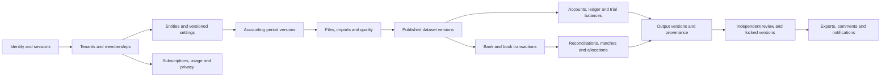

# SRS database implementation — 3 November 2026

The schema implements the **relational storage model** for SRS-FIN-001 version 1.0. It covers the 45 FR entries, including subsequent-release storage structures. It does **not** claim that every workflow, security control, integration or non-functional acceptance criterion has been implemented. Normalized tables now back the real authenticated workspace, classified trial-balance drafts, paired bank-source intake and [documented one-to-one matching decisions](BACKEND-MATCHES-V4.md). The demonstration's single-operator snapshot archive remains separate; the complete review, scanning and integration lifecycle is still unfinished.

## Deliverables

- `database/schema.mjs`: reviewable definitions and requirement links for **107 new business tables**.
- `database/guards.sql` and `database/hardening.sql`: database integrity functions and triggers.
- `migrations/002_srs_relational_model.sql` and `003_srs_integrity_guards.sql`: additive generated SQL. Existing migration 001 and its `financial_snapshots` data are preserved.
- `migrations/004_access_lifecycle_guards.sql`: reviewed additive hardening for bank-scoped approval, supervisor override permission and one-way provider-approval revocation. This migration is maintained directly, outside the schema generator.
- `migrations/005_required_workflow_evidence.sql`: explicit non-null reasons and fingerprints for reopening, reversals, cleared/excluded items and review withdrawals; maintained directly. These additional constraints refine the generated dictionary's base definitions.
- `migrations/009_match_request_idempotency.sql`: additive unique index on scoped matching decision request keys. No business columns or tables are changed; this index supplements the generated catalog and is maintained directly.
- `migrations/010_membership_review_services.sql` through `013_explicit_membership_reactivation.sql`: private idempotency ledger and narrowly granted membership/invitation/review functions, active-scope and period guards, and explicit reactivation without restored privileges. No new business tables are added to `mizan`. See [services and verification](BACKEND-REVIEW.md).
- `migrations/014_reconciliation_evidence_capacity.sql`: forward-only current clean-source/evidence approval checks and prevention of reusing classified movement capacity in matching allocations. See [adjusted statements](BACKEND-RECONCILING-ITEMS.md).
- `migrations/015_scan_job_leases.sql` through `017_active_account_permissions.sql`: private fenced scan leases, narrow asynchronous source/job bridges, explicit NULL-token checks and global active-account authorization. No new business tables are added to `mizan`. See [source jobs](BACKEND-SOURCE-JOBS.md).
- [Field dictionary](DATABASE-FIELDS.md): every business table, field type, nullability, check and declared relationship; scope keys and FK indexes are generated consistently.
- [Machine-readable inventory](database-tables.json).
- [Applied database catalog](DATABASE-CATALOG.md): actual final columns, constraints and triggers introspected from Postgres, including the additional guards in migrations 003–005. `npm run db:catalog` reads schema metadata only.
- `verification/srs-database.mjs`: real database integration tests, including concurrency on the isolated branch. JSON evidence is in `verification/srs-database-branch.json` and `verification/srs-database-production.json`.

There are **109 tables in the mizan schema** after deployment: 107 business tables, the legacy `financial_snapshots` archive, and `schema_migrations`. Other database schemas are not changed.

## Domain map



## Requirement traceability

This is **storage coverage**, not a declaration that the corresponding service is complete.

| SRS | Principal tables | Remaining service work |
|---|---|---|
| FR-001 | app_users, user_sessions, invitations, invitation_grants, security_events | Real identity provider, recovery, MFA verification, email delivery and sensitive-action reauthentication |
| FR-002 | tenants, legal_entities, memberships | Organization APIs and identity-derived scope |
| FR-003 | roles, permissions, role_permissions, membership_roles, access_grants | Per-action authorization on every API, worker and download |
| FR-004 | entity_settings_versions, currencies, bank_accounts | Configuration version selection and impact workflow |
| FR-005 | accounting_periods, reopen_events | Authorized close/reopen endpoints and policy |
| FR-006 | source_files, processing_jobs | Object storage, content/malware scanners and upload limits |
| FR-007 | import_templates, source_rows, row_transformations | Server parser and preview workflow |
| FR-008 | import_templates | Template compatibility detection |
| FR-009 | import_batches, dataset_versions, dataset_imports, accounts, ledger_entries, trial_balance_rows, bank_transactions, book_transactions | Normalized ingestion workers |
| FR-010 | source_files, duplicate_candidates, import_batches | Similarity detection and overlap analysis |
| FR-011 | quality_runs, quality_issues, row_dispositions | Quality calculation and issue resolution workflow |
| FR-012 | source_rows, row_transformations, row_dispositions | Correction/revalidation APIs |
| FR-013 | processing_jobs, job_attempts | Queue, leases, retry/cancellation and dead-letter handling |
| FR-014 (S) | provider_approvals, ocr_runs, ocr_fields | Approved provider, extraction and human review |
| FR-015 | report_line_items, mapping_versions, account_mappings | Mapping APIs and accountant-approved taxonomy |
| FR-016 | output_versions, report_lines, validation_results, output_datasets | Normalized calculation engine and reference accounting cases |
| FR-017 | output_datasets, metric_results, formula_versions, exchange_rates | Comparison engine and disclosure |
| FR-018 | formula_versions, metric_results, trade_items, trade_settlements | Approved definitions, aging and calculation inputs |
| FR-019 | report_line_sources, source_rows, ledger_entries, trial_balance_rows | Drill-down API and calculation provenance population |
| FR-020 | exception_rule_versions, exception_results | Explainable rule evaluation |
| FR-021 | analysis_narratives, metric_results | Deterministic numeric explanations |
| FR-022 (S) | output_versions, formula_versions, ledger_entries, account_mappings | Agreed cash-flow method, classifications and supporting data |
| FR-023 (S) | provider_approvals, ai_narrative_runs, analysis_narratives | Provider approval, minimized input, source-checked generation; disabled |
| FR-024 (S) | dimensions, dimension_values, ledger_dimensions, budget_versions, budget_lines, planning_versions, output_budget_versions, output_planning_versions | Budget/scenario engine and compatible dimensions |
| FR-025 | reconciliations, bank_accounts, output_versions | Reconciliation API and overlap warnings |
| FR-026 | bank_transactions, book_transactions, reconciliations | Source-specific sign normalization and completeness validation |
| FR-027 | matching_rule_versions, reconciliation_rule_bindings, match_groups, match_decisions | Deterministic unique-candidate matcher |
| FR-028 | match_groups, match_group_members | Candidate evidence and ambiguity engine |
| FR-029 | match_groups, match_group_members | Bounded grouped search; no automatic group approval |
| FR-030 | allocations | Allocation API with conflict reporting; DB enforces atomic amount limits |
| FR-031 | match_decisions, allocations | Authorized accept/reject/unmatch endpoints and supervisor overrides |
| FR-032 | reconciling_items, reconciliation_items, attachments | Difference classification and scoped evidence handling |
| FR-033 | proposed_entries, proposed_entry_lines, reconciliations | Proposed-entry validation and statement rendering; no posting |
| FR-034 | reconciling_items, reconciliation_items, proposed_entries | Carry-forward selection and imported-entry linking |
| FR-035 | matching_quality_runs | Independent ground truth and statistically valid precision measurement |
| FR-036 | review_submissions, review_decisions, validation_results, user_sessions | Trusted validation population and authenticated review endpoints |
| FR-037 | output_versions, reopen_events | Authorized new-version workflow and change summaries |
| FR-038 | export_artifacts, processing_jobs | Version-bound export workers and authorized download links |
| FR-039 | comments, attachments, notifications, notification_deliveries | Collaboration, safe email templates and delivery |
| FR-040 | audit_events | Audit population on every service path, hash chaining and external tamper-resistant storage |
| FR-041 | plan_versions, subscriptions, invoices, payment_events, usage_buckets, usage_events | Billing provider, verified/out-of-order webhooks and quota admission |
| FR-042 | retention_policy_versions, data_lifecycle_requests, legal_holds, deletion_manifest, backup_restore_runs | Approved retention policy, deletion/export workers and real recovery drills |
| FR-043 | support_requests, support_access_grants, support_access_events | Customer-authorized support sessions and scoped authorization |
| FR-044 (S) | integration_connections, sync_runs, external_record_versions | Read-only provider connectors and conflict detection |
| FR-045 (S) | api_clients, api_client_entities, api_idempotency_keys, webhook_endpoints, webhook_deliveries, webhook_receipts | Credential verification, signatures, replay windows, SSRF checks and rate limits |

## Integrity decisions

- **Tenant/entity scope (DR-001):** scoped business rows carry tenant and entity IDs where relevant. Composite foreign keys prevent linking records from another tenant/entity; bank/account/currency links use composite keys too. UUIDs are not authorization.
- **Exact amounts (DR-002–003):** `mizan.exact_amount` is an unscaled numeric domain that rejects nonfinite values, more than eight fractional digits and magnitudes at or above 10^22. Currency triggers reject values not representable at the currency's configured precision; values are rejected instead of silently rounded. This capacity is an implementation decision requiring confirmation against real samples. Rates use exact numeric with a separate precision limit. No balance uses floating point.
- **Dates (DR-004):** accounting dates use `date`; system events use `timestamptz`.
- **Originals (DR-005, DR-009):** original file identity and raw rows cannot be overwritten; derivations and exclusions are separate records. A published import rejects new original rows. Storage immutability/encryption itself must be enforced by the storage provider.
- **Idempotency (DR-006):** fingerprints, logical IDs, versions and operation-specific unique keys cover imports, jobs, allocations, usage, billing events and integrations. No source transactions are deduplicated merely because they look alike.
- **Text identifiers (DR-007):** codes, references, external IDs and protected bank identifiers remain text.
- **Missing values (DR-008):** missing/not-applicable results have null amounts and explanations; zero is a valid available value.
- **Allocation (DR-010):** transaction row locks plus aggregate checks prevent total active allocation exceeding either side's magnitude. Reversals require actor/reason and retain history. Negative cash flows are supported without reversing sign meaning.
- **Currency conversion (DR-011):** cross-currency matches are rejected; exchange rates retain source, date, policy and approver. The conversion engine is not implemented by table creation.
- **Versions (DR-012):** published datasets/mappings and approved outputs are frozen. Submitted output content and its child results cannot change. New versions retain predecessor and reason. Budget/planning bindings identify the versions used by an output.
- **Approval:** independent reviewer, tenant/entity/bank-scoped approval permission, active MFA session, current fingerprint, required validation results and complete published datasets are checked. Reference-conflict overrides need a separate supervisor grant. Reconciliation approval also verifies roll-forward, difference evidence, zero residual and prevention of double-counted linked entries. Stored validation success must come from trusted deterministic services; table creation does not certify calculation correctness.
- **Usage:** reservations/consumption update a locked bucket atomically. Unique usage events cannot double-consume on redelivery.
- **Audit:** client DML cannot update/delete append-only events. Provider approval contracts are immutable but allow one-way revocation; revoked providers cannot start new runs. A database owner can still disable triggers or bypass RLS; this is not cryptographic tamper-proofing.

## Isolation and authentication boundary

RLS is enabled and forced on all scoped business tables. Policies deny missing context. The authenticated server must use a **non-owner, non-BYPASSRLS role** and set transaction-local `mizan.tenant_id`, `mizan.user_id`, and comma-separated `mizan.entity_ids` only after verifying real membership/action grants. Never accept these settings from browser inputs. Pool traffic must use one checked-out connection for the complete transaction.

The present application connection is `neondb_owner`, which has BYPASSRLS. It remains in the existing local snapshot integration; the new normalized tables are not exposed by that API. No public REST/Data API, real user authentication or least-privilege production connection was provisioned in this task. Integration tests temporarily create a non-login non-bypass role inside a rolled-back transaction to test real RLS behavior.

Identity tables map provider subjects and hashed session references; they are **not** a custom password/MFA implementation. Bank/description columns ending in `_ciphertext` and key/secret-reference fields define the protection contract; a future key-management service must produce and rotate actual ciphertext. Never store plaintext in those fields in real use.

## Migrations, verification and rollback

```powershell
npm run db:generate
npm run db:migrate
npm run db:verify             # only on a codex-srs-schema test branch
npm run db:verify:production  # production fixtures are entirely rolled back
npm run build
npm test
```

The migration runner pins a direct connection, serializes migration runners with an advisory lock, records SHA-256 checksums and applies each file and its ledger entry in one transaction. Reruns are no-ops; editing an applied migration fails. Migration 001 is adopted idempotently without rewriting its source. New revisions require new numbered migrations.

Before production, development checks run on `codex-srs-schema` and the final clean replay runs on `codex-srs-schema-final`, both branched from production with the existing seven-day TTL. Production tests roll back all synthetic records and the temporary RLS role. The committed concurrency fixture exists **only** on disposable branches and expires with them. No real customer data is inserted, transformed or deleted by the verification suite.

If a migration fails it rolls back that file. After successful application, rollback is **forward-only**: keep the old app using its legacy archive, disable new endpoints, and apply a reviewed repair migration. Do not drop the mizan schema or disable guards in production. A disaster restore must reapply deletion and access-revocation records before access; the schema stores evidence but does not perform provider backups.

## Open decisions and limits

Final verification: **55 database checks passed** on the isolated branch, including the real concurrent-allocation race; **54 passed on production** with all synthetic business data and the temporary test role rolled back. The existing snapshot browser workflow passed **4 end-to-end checks** after migration, and its synthetic archive rows were removed. Application build and the existing **60 tests** passed. See the versioned JSON evidence in `verification/`.

The SRS is a draft. No jurisdiction, legal retention period, paid plan price, financial tolerance or accounting formula approval has been invented. Retention policies, limits and providers are stored as configurable/versioned records. Only a small reference currency catalog and permission/role definitions are seeded; no tenant, account, user, provider approval, price or operational plan is seeded in production.

Remaining work includes all normalized APIs/workers and UI integration, action-level authentication, encryption and object storage, accounting validation of formulas and mappings, out-of-order billing handling, delivery/retry infrastructure, performance/load tests, independent accounting reference cases, full security review and an actual backup/restore exercise. Passing schema tests is not full SRS acceptance or production-readiness certification.
